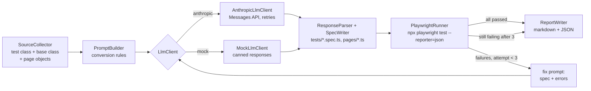

# Playwright AI Lab

> New here? Start with [docs/walkthrough.md](docs/walkthrough.md).

A Java command-line tool that migrates a Selenium/JUnit 5 UI test suite to Playwright TypeScript
with an LLM. It then runs the converted specs and sends any failures back to the model until they pass.

The code the model writes gets executed right away. A converted spec only counts as migrated
once it passes against the real application, and the report shows which Selenium idioms (explicit
waits, `Select`, `findElements`, ...) were replaced and whether any Playwright anti-patterns remain.

```
legacy-selenium-suite/   Selenium 4 + JUnit 5 suite (input): 3 test classes, 6 tests, 1 page object
migrator/                Java 17 CLI: collects sources, prompts the LLM, writes specs, runs them, fixes, reports
playwright-output/       Playwright Test project (output): converted specs in tests/, page classes in pages/
docs/                    Sample migration report and a sample model conversation
```

The tests target the public demo site https://the-internet.herokuapp.com.

## How it works



For each test class the migrator:

1. **Collects sources.** It reads the test class, the page objects it imports (and any they depend on),
   and same-package support classes such as `BaseTest`, which holds the implicit wait.
2. **Builds a prompt.** The system prompt holds the conversion rules. Waits are removed in favour of
   auto-waiting and web-first assertions. `Select` becomes `selectOption`. `findElements` becomes a
   locator with `nth()`/`toHaveCount()`. Page objects become TypeScript classes that expose `Locator`s.
   Every assertion is preserved one for one.
3. **Writes the files** the model returns. Only `tests/*.spec.ts` and `pages/*.ts` are accepted, so a
   response can't overwrite the Playwright config or escape the project directory.
4. **Runs the spec** with `npx playwright test <spec> --reporter=json --retries=0` and parses the result.
5. **Fixes failures.** On failure, the errors are appended to the same conversation (up to 3
   attempts in total). The fix prompt tells the model not to loosen or delete assertions to get a pass.
6. **Checks the output.** It scans the final TypeScript for leftover anti-patterns (`waitForTimeout`,
   `expect(await locator.textContent())`, `expect(await x.count())`, XPath, ...) and writes the report.

## Running it

Prerequisites: JDK 17+ (built and tested with 21), Maven 3.9, Node 20+.

```bash
# 1. Playwright project
cd playwright-output
npm ci
npx playwright install chromium

# 2. Build the migrator (runs the unit tests too)
cd ../migrator
mvn package

# 3a. Mock mode: no API key needed. Specs are still really executed against the site.
LLM_PROVIDER=mock java -jar target/migrator.jar

# 3b. Real model
export ANTHROPIC_API_KEY=...          # never commit this
java -jar target/migrator.jar         # provider defaults to anthropic when a key is set
LLM_MODEL=claude-opus-5-5 java -jar target/migrator.jar
```

| Variable | Meaning | Default |
|---|---|---|
| `LLM_PROVIDER` | `anthropic` or `mock` | `anthropic` if `ANTHROPIC_API_KEY` is set, otherwise `mock` |
| `LLM_MODEL` | Anthropic model id | `claude-sonnet-5-5` |
| `ANTHROPIC_API_KEY` | API key for the `anthropic` provider | - |
| `ANTHROPIC_BASE_URL` | Optional API base URL, e.g. a proxy | `https://api.anthropic.com` |

Useful options (`java -jar target/migrator.jar --help`):

```
-t, --test=<name>       Migrate one class (repeatable), e.g. -t LoginTest
    --max-attempts=<n>  Generate/run attempts per class (default 3)
    --no-run            Convert only; don't run Playwright or attempt fixes
    --source / --output / --report-dir   Override the default paths
```

Outputs:

- `playwright-output/tests/*.spec.ts`, `playwright-output/pages/*.ts`: the converted suite
- `migrator/target/migration-report/migration-report.{md,json}`: the migration report
- `migrator/target/migration-report/conversations/<TestClass>.md`: the full prompt/response history

Run the converted suite on its own with `cd playwright-output && npx playwright test`.
The legacy suite still runs with `cd legacy-selenium-suite && mvn test` (needs Chrome).

## Sample output

A mock-mode run from this repository:

```
LLM: mock (canned responses)
Migrating 3 test class(es): DynamicLoadingTest, FormControlsTest, LoginTest
== DynamicLoadingTest -> tests/dynamic-loading.spec.ts
   attempt 1: 1/1 passed
   result: PASSED after 1 attempt(s)
== FormControlsTest -> tests/form-controls.spec.ts
   attempt 1: 3/3 passed
   result: PASSED after 1 attempt(s)
== LoginTest -> tests/login.spec.ts + pages/LoginPage.ts
   attempt 1: 0/2 passed - 2 failure(s)
   attempt 2: 2/2 passed
   result: PASSED after 2 attempt(s)

Done: 3/3 passing (2 first attempt, 1 after fixes), 0 failed, 0 not run, 0 errors
```

- [docs/sample-migration-report.md](docs/sample-migration-report.md): the report from that run
- [docs/sample-conversation-login.md](docs/sample-conversation-login.md): the exact prompts sent for
  `LoginTest`, including the fix request with the real Playwright error

The canned first response for `LoginTest` contains a deliberate, realistic mistake. The Java test checks
`flashMessage().contains("You logged into a secure area!")`, and the first conversion turns that into
an exact `toHaveText(...)`. The flash element also contains whitespace and a close button, so the
assertion fails on the live site. The failure is fed back, and the second response switches to
`toContainText`, which is what the original assertion meant. This way the fix loop runs for real
even without an API key.

An example of a converted test:

```ts
// Java: new WebDriverWait(driver, 10).until(visibilityOfElementLocated(...)); assertEquals(..., getText())
test('hidden element appears after loading', async ({ page }) => {
  await page.goto('/dynamic_loading/1');
  await page.locator('#start button').click();
  await expect(page.locator('#finish h4')).toHaveText('Hello World!');
});
```

## Testing

`mvn test` in `migrator/` runs 54 JUnit 5 tests. They are fully offline, with no API key, network or
browser needed:

| Area | What is covered |
|---|---|
| `SourceCollector` | test discovery, transitive page objects, base class as context, ignoring names in comments/strings |
| `PromptBuilder` | conversion rules present, targets listed, fix prompt contents, truncation |
| `AnthropicLlmClient` | request shape and headers against a local stub server, retry on 429/529/503 with `retry-after`, no retry on 400, refusal and truncation handling |
| `MigrationEngine` | fix loop with `MockLlmClient` and a scripted runner: pass after fix, give up after max attempts, malformed responses, LLM errors, `--no-run` |
| `PlaywrightJsonParser` | real JSON reports captured from Playwright (assertion failure, syntax error) |
| `ReportWriter` / `SpecWriter` / `ResponseParser` | report content and JSON, path safety, response parsing |

CI (`.github/workflows/ci.yml`) runs the unit tests. It then deletes the committed specs, regenerates
them with the mock provider, type-checks them and runs the full Playwright suite against the live site.

## Design decisions

- **Execution is the acceptance test.** A plausible-looking conversion isn't enough. Each spec is
  run, and the result (not the model's opinion) decides whether the migration succeeded.
- **One conversation per test class.** Fix requests are appended to the original conversation instead
  of starting over, so the model sees its own previous answer next to the error. The history is only
  ever appended to, never edited.
- **Guardrails against "fixing" by weakening.** The fix prompt forbids deleting or loosening assertions
  and adding fixed waits. The pattern scan independently flags `waitForTimeout` and non-web-first
  assertions, even when the tests pass.
- **Page objects stay page objects.** They are converted to TypeScript classes rather than inlined, which
  keeps the structure familiar to the team that owns the suite. Methods that returned text now expose
  `Locator`s so tests can use retrying assertions.
- **Plain `java.net.http` for the API.** One endpoint and a small JSON body didn't justify an SDK
  dependency. Retries cover 429, 529 and 5xx with exponential backoff that honours `retry-after`. For
  models that support it, the request opts into server-side refusal fallback (`fallbacks: "default"`).
  A refusal or a response truncated at `max_tokens` is reported as an error instead of being written out
  as a half-finished file.
- **Regex-based source collection** instead of a Java parser. That's enough for conventional page-object
  suites and keeps the tool small. It's also the first thing to replace for messier codebases (see below).
- **Mock mode is a first-class provider.** Anyone can clone the repo and see the whole pipeline, including
  a real failure and a real fix, without credentials.

## Limitations and next steps

- Source collection follows imports and same-package references only. Inherited helper methods, static
  utilities in other packages, or dependency injection would need a real parser (e.g. JavaParser).
- Page classes shared by several test classes are generated once per run and passed to later
  conversions as "keep this API". Two classes that need conflicting changes to the same page aren't
  reconciled automatically.
- Specs are run one class at a time and serially, which is fine for a small suite but slow for hundreds of classes.
- The pattern checks are heuristics. They catch the common anti-patterns, not every one.
- Passing isn't the same as being equivalent. A human should still review each converted spec against the
  original, especially where the model changed a locator strategy (for example XPath to `getByRole`).
- Tests that are hard to migrate automatically: custom `WebDriver` wrappers, JavaScript executor hacks,
  multi-window/iframe flows with hand-rolled waits, and data-driven tests fed from external files.
  These should be flagged for manual migration rather than retried blindly.
- Possible extensions: parallel conversion, a diff view of attempt N vs N+1, and a cost/token summary in
  the report for real-model runs.
